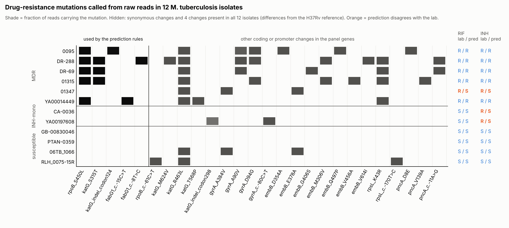

# From raw reads to drug-resistance prediction in *Mycobacterium tuberculosis*

A variant-calling pipeline that starts from raw Illumina reads of clinical TB isolates, finds mutations known to cause
resistance to **rifampicin (RIF)** and **isoniazid (INH)**, and checks its predictions against drug resistance measured
in the laboratory.

**Pipeline:** fastp → BWA-MEM → samtools → bcftools (haploid calling) → annotation in Python → rule-based prediction →
comparison with laboratory drug-susceptibility testing. Runs end-to-end in Google Colab.



## Data
- **Isolates and lab results:** CRyPTIC Consortium Dataset v3.4.0 (Zenodo record 15680920): `UKMYC_PHENOTYPES` for
  laboratory phenotypes, `WGS_SAMPLES` for the link to sequencing runs. Only high-quality phenotypes were used.
- **Reads:** European Nucleotide Archive (run accessions in `results/tables/samples.csv`).
- **Reference:** *M. tuberculosis* H37Rv, NCBI RefSeq GCF_000195955.2 (NC_000962.3).
- **Sample choice:** 12 isolates drawn at random (fixed seed) from three lab-defined groups: 6 multidrug-resistant
  (RIF-R, INH-R), 2 isoniazid-only resistant, 4 susceptible to both. Paired-end Illumina runs only.

## Method in brief
1. Stream the first 750,000 read pairs per isolate (about 50x coverage of the 4.4 Mb genome).
2. Trim with fastp; align with BWA-MEM; sort and index with samtools; measure coverage per gene.
3. Call variants in eight resistance genes (*rpoB, katG, fabG1, inhA, gyrA, embB, rpsL, pncA*, plus 200 bp upstream)
   with `bcftools call --ploidy 1`; keep calls with QUAL ≥ 20 and depth ≥ 10.
4. Annotate each variant to its protein change (handling genes on both strands) after checking the gene coordinates
   against known codons (e.g. serine at *rpoB* codon 450).
5. Predict resistance with a simplified subset of high-confidence rules from the WHO mutation catalogue:
   - **RIF:** any amino-acid change in the *rpoB* rifampicin-resistance-determining region (codons 426–452);
   - **INH:** *katG* codon 315 changes, *katG* stop or frameshift, or *fabG1* promoter c.-15C>T / c.-8T>C/A.

## Results
All numbers are in [`results/summary.md`](results/summary.md), generated by `scripts/summarise_results.py`.

**Sequencing quality.** Median depth 47x; at least 98.7 % of the genome covered in 11 of 12 isolates; at least 25x in *rpoB*,
*katG* and *fabG1* in every isolate.

**Agreement with the laboratory**

| Drug | Sensitivity (95 % CI) | Specificity (95 % CI) |
|---|---|---|
| Rifampicin | 5 / 6 = 83 % (44–97 %) | 6 / 6 = 100 % (61–100 %) |
| Isoniazid | 5 / 8 = 62 % (31–86 %) | 4 / 4 = 100 % (51–100 %) |

With 12 isolates the intervals are wide. This demonstrates the pipeline; it is not an estimate of diagnostic accuracy.

**Mutations found.** *rpoB* S450L in all five correctly called RIF-resistant isolates. INH resistance came from
*katG* S315T (3 isolates), a frameshift in *katG* (1) and *fabG1* promoter mutations (2; one isolate also had S315T).
No resistance mutation was called in any lab-susceptible isolate.

**Four changes appear in every isolate** (*gyrA* E21Q, S95T, G668D and *rpsL* c.-165T>C). They are differences
between the H37Rv reference strain and these clinical isolates, not resistance, and are hidden from the figure.
This is why resistance prediction needs a curated catalogue rather than "any mutation = resistant".

## The discordant isolates
| Isolate | Lab | Predicted | What the data show |
|---|---|---|---|
| 01347 | RIF-R, INH-R | S, S | No change in *rpoB*, *katG*, *fabG1* or *inhA*, with at least 33x coverage of each. Missing both drugs at once points more towards a sample or record mismatch, or a mixed culture, than towards two independent unknown mechanisms; these data cannot tell which. |
| YA00197608 | INH-R | S | A 24-bp in-frame deletion in *katG* (around codon 298), in 73 % of reads. Plausibly destroys katG function, and the read fraction suggests a mixed population. The rules only counted frameshifts and stop codons, and were **not** changed after seeing this result. |
| CA-0036 | INH-R | S | No change in any INH gene in the panel. INH resistance can also arise from genes outside this panel. |

**A pipeline issue found along the way.** Isolate PTAN-0359 had only 56 % of the genome covered, with no reads on
*embB* but around 90x on genes in the first half of the genome. Its FASTQ file appears to be ordered by genome
position, so "the first 750,000 read pairs" covered only the first ~2.5 Mb. *rpoB*, *katG* and *fabG1* all lie in that
region (73–95x), so its RIF and INH calls stand, but anything in *embB* could not be called. The fix is to subsample
reads at random instead of taking the first N (planned below).

**Beyond RIF and INH (not evaluated against lab results).** Four of the six MDR isolates carry *gyrA* A90V and/or
D94G, well-known fluoroquinolone-resistance mutations; *embB* M306V (ethambutol) and *rpsL* K43R (streptomycin) also
appear. Comparing these with the lab results for those drugs is the next step.

## Run it
1. Open `notebooks/tb_resistance_pipeline.ipynb` in Google Colab and choose `Runtime → Run all` (about 45–60 min; all
   data are open, no sign-in needed). It downloads `results.zip`.
2. Put the tables from `results.zip` into `results/tables/`, then:
   ```bash
   pip install -r requirements.txt
   python scripts/summarise_results.py
   ```
The notebook in this repository is the version that produced these results.

## Layout
```
notebooks/   tb_resistance_pipeline.ipynb   the full pipeline, with explanations
results/     tables/ (samples, QC, variants, predictions, performance), fastp/ QC reports, summary.md
figures/     resistance_mutations.png
scripts/     summarise_results.py           summary and figure from the tables
docs/        LEARNING_LOG.md                questions I can answer about every step
```

## Limitations and next steps
- 12 isolates; the confidence intervals are wide.
- Simplified rules, not the full WHO catalogue. **Next:** apply the full catalogue and compare with an established tool
  (TB-Profiler) on the same reads.
- Subsampling took the first N reads. **Next:** random subsampling, plus a QC rule that blocks predictions when a gene
  is under-covered.
- Small indels and mixed infections are the hardest calls for a short-read, haploid caller; the *katG* results show both.
- **Next:** extend the comparison to fluoroquinolones, ethambutol and streptomycin, and to a few hundred isolates.

## How this was built
The code was written with the help of an AI assistant (Claude). I ran the pipeline, chose the questions, checked the
results and wrote the interpretation of the discordant isolates.

## Licence and credits
Code: MIT. Data: CRyPTIC Consortium (Zenodo record 15680920; see the record for terms of reuse) and the European
Nucleotide Archive. Reference genome: NCBI RefSeq.

## Author
Abhishek Kumar Mandal, M.Sc. Zoology, Banaras Hindu University
abhishekdhn2002@gmail.com · [LinkedIn](https://www.linkedin.com/in/abhishek-kumar-mandal-6750a0315)
